# Presente! Chamada

> **Global Solution 2026.2 · CitizenTech** · Android Kotlin Developer (Prof. Ewerton Carreira)
> App Android nativo em **Kotlin + Jetpack Compose** usado pelo professor em sala: a chamada que vira cuidado.

| Integrante | RM |
|---|---|
| Juan Marini | 556678 |
| Samuel Okuma | 555370 |
| Arthur Menon | 555918 |

**ODS:** 4 Educação de qualidade (meta 4.1) e 10 Redução das desigualdades (meta 10.2).

**🎥 Vídeo pitch:** https://youtu.be/gJzWQKifPXM

**📦 Repositório:** https://github.com/juan-marini/presente-kotlin

---

## 1. O problema

Quando um aluno de escola pública começa a faltar, a escola normalmente só **conta** as faltas e, no máximo, manda um aviso. Ninguém descobre **por que** ele está faltando. E o motivo quase nunca é preguiça: é trabalho para ajudar em casa, falta de transporte, saúde, bullying, cuidar de um irmão mais novo, gravidez, mudança de endereço ou desmotivação. Cada motivo tem uma porta certa na rede pública (CRAS, UBS, Conselho Tutelar, passe livre), mas a família não sabe qual é, e a escola não tem braço para conversar com todos. O aluno acumula faltas até evadir, e a intervenção chega tarde.

- O abandono no ensino médio público caiu para 2,2% em 2025 (Censo Escolar/Inep), mas 19,4% dos jovens de 15 a 17 anos estão fora do ensino médio.
- O Pé-de-Meia paga até 9 parcelas de R$ 200 por ano e exige **frequência mínima de 80%**. Faltar tem custo direto, e quem mais falta é justamente quem mais precisa do benefício.

## 2. A solução Presente! e o papel deste app

O **Presente!** é um assistente de **busca ativa escolar**: em vez de só avisar a falta, conversa com a família pelo WhatsApp, descobre o motivo e encaminha o caso para quem pode resolver. Humano sempre no circuito: a IA sugere, o profissional decide. Dados de menores tratados conforme a LGPD.

Cada entrega da GS é uma peça do mesmo produto:

```
Kotlin (este app)          Microsserviços (Java/Spring)        Bot WhatsApp           Flutter
Professor faz a chamada -> ms-alunos recebe a frequência  ->  conversa com a  ->  agente de campo
e o gatilho é avaliado     ms-casos abre o caso de busca      família, no idioma   acompanha o caso
                           ativa                              dela
```

O **Presente! Chamada** é a **origem das faltas**, que antes era simulada por um CSV:

- Lista da turma e chamada com **um toque** (presente/falta).
- **Offline-first com Room:** a chamada é salva no aparelho e sincroniza quando houver internet (a escola nem sempre tem conexão boa).
- Mostra ao professor quem está em **alerta** e se já existe caso aberto.
- Ao bater o gatilho, **abre o caso de busca ativa** no backend, que dispara a conversa no WhatsApp.

### Regra do gatilho (`domain/RegraGatilho.kt`)

| Nível | Quando |
|---|---|
| **Alerta** | 3 ou mais faltas seguidas **ou** frequência abaixo de 80% (mínimo do Pé-de-Meia) → permite abrir caso |
| **Atenção** | 2 faltas seguidas **ou** frequência abaixo de 85% |
| **Em dia** | demais casos |

A regra fica isolada, sem dependência de Android, e tem **testes unitários** (`app/src/test/.../RegraGatilhoTest.kt`).

## 3. Fluxo e telas

```
Início ──► Minhas turmas ──► Chamada da turma ──► Detalhe do aluno ──► Abrir caso
   │                                                   ▲
   └──────► Alunos em risco (todas as turmas) ─────────┘
```

| 1. Início | 2. Minhas turmas | 3. Chamada da turma |
|---|---|---|
| 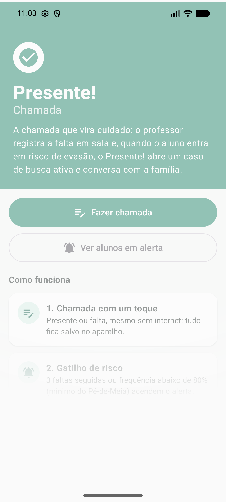 | 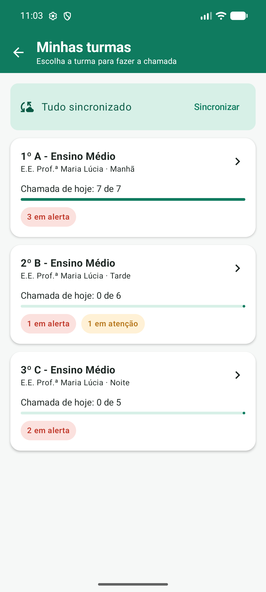 | 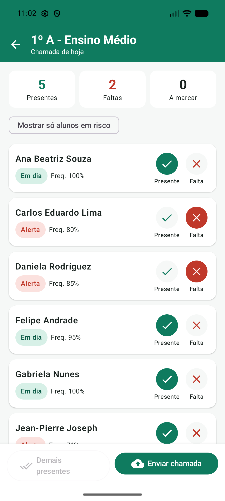 |
| Nome, objetivo, como funciona e atalhos. | Progresso da chamada de hoje e alunos em risco por turma. | Um toque marca presente/falta. Filtro "só alunos em risco" e "Demais presentes". |

| 4. Chamada enviada | 5. Detalhe do aluno | 6. Caso aberto |
|---|---|---|
| 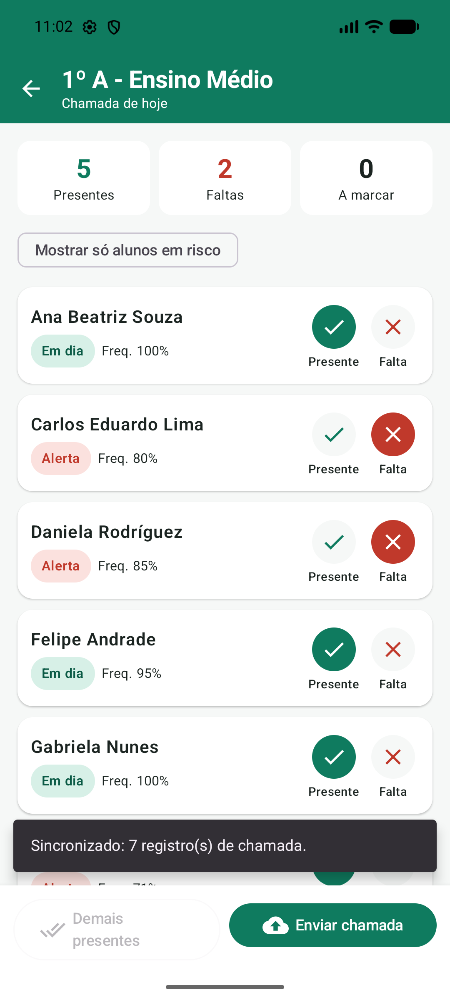 | 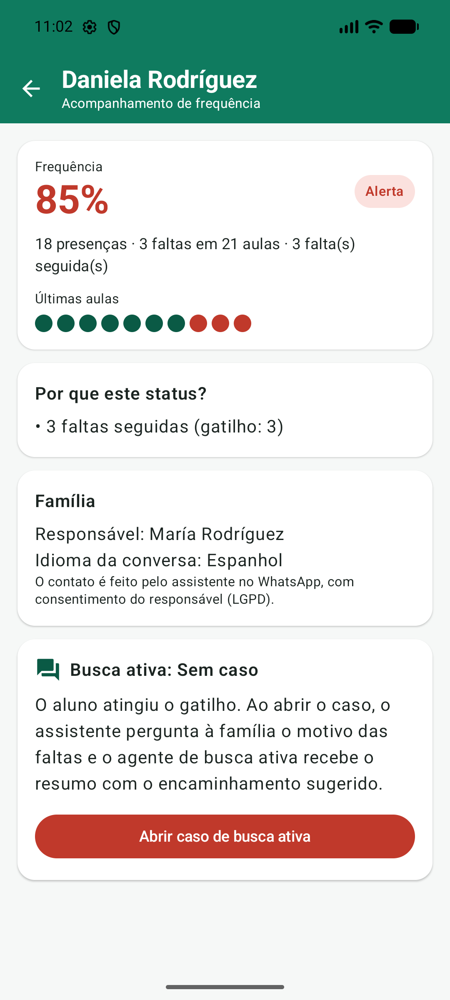 | 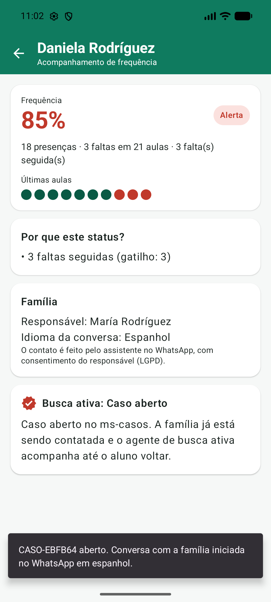 |
| Envio ao backend via `PresenteApi`. Daniela virou **Alerta** ao completar 3 faltas seguidas. | Frequência, últimas aulas, motivo do status, família e idioma da conversa. | O caso vai ao ms-casos e o bot inicia a conversa no idioma da família (aqui, espanhol). |

| 7. Alunos em risco | 8. Simular sem internet | 9. Chamada sem internet |
|---|---|---|
| 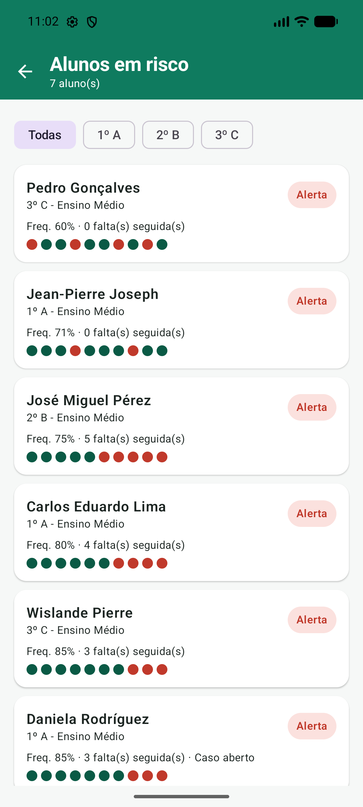 | 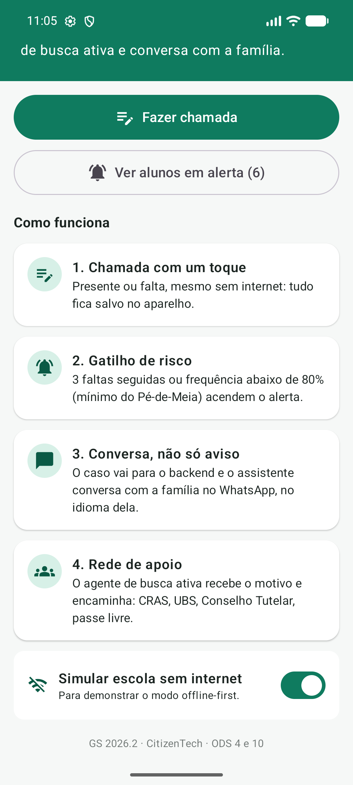 | 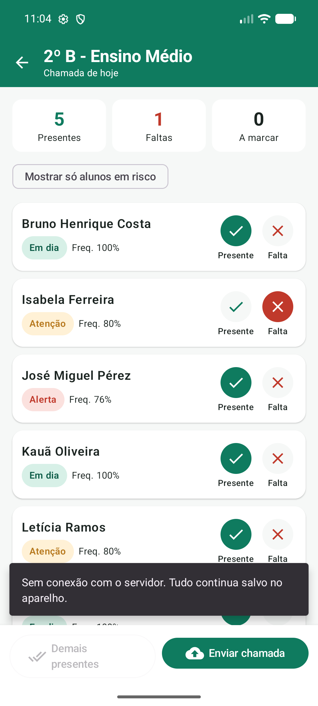 |
| Todos os alunos em risco, do mais grave ao menos grave, com filtro por turma. | Chave de demonstração do modo offline-first. | Sem conexão, nada se perde: a chamada fica salva no aparelho. |

| 10. Pendências | 11. Sincronizado |
|---|---|
| 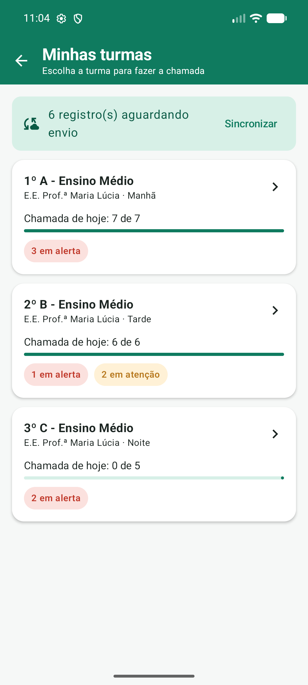 | 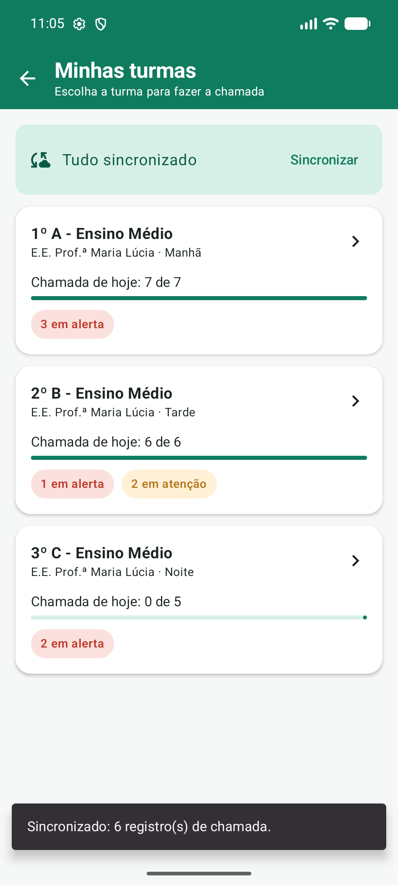 |
| Registros aguardando envio ficam visíveis ao professor. | Com a conexão de volta, um toque em "Sincronizar" envia tudo. |

## 4. Como os requisitos da disciplina foram atendidos

| Requisito | Onde está |
|---|---|
| Tela inicial com nome, descrição e identidade visual | `ui/screens/InicioScreen.kt`, tema em `ui/theme/`, ícone adaptativo em `res/` |
| Navigation Compose com 3+ telas | `ui/navigation/PresenteNavHost.kt`: 5 rotas, duas com argumento (`chamada/{turmaId}`, `aluno/{alunoId}`) |
| Componentes Compose e organização visual | `Scaffold`, `TopAppBar`, `LazyColumn`, `LazyRow`, `Card`, `Row`, `Column`, `FilterChip`, `Switch`, `Snackbar` |
| Dados ligados ao tema | Turmas e alunos simulados (`data/mock/DadosMock.kt`) com padrões de falta reais do problema; envio por **Retrofit** (`data/remote/PresenteApi.kt`) |
| Interação com o usuário | Marcar presença/falta, "Demais presentes", filtros, abrir caso, sincronizar, simular sem internet |
| Organização e boas práticas | MVVM (`ViewModel` + `StateFlow`), pacotes `data` / `domain` / `ui`, repositório como fonte única, regra de negócio testada, código compilando |

### Conceitos da aula aplicados (Projeto Crypto Monitor)

- **REST + JSON:** `PresenteApi` define `POST api/frequencias` e `POST api/casos`; o Gson converte o JSON para data classes Kotlin.
- **Códigos HTTP:** respostas fora de 2xx (e falhas de rede) viram exceção, e o repositório trata como "salvo offline" sem perder dados.
- **Consumo de serviço externo:** o app conversa com o API Gateway dos microsserviços, assim como o Crypto Monitor consulta a API do Mercado Bitcoin.

## 5. Arquitetura

```
app/src/main/java/br/com/fiap/presente/chamada/
├── PresenteApp.kt              # cria banco, API e repositório (injeção manual)
├── MainActivity.kt
├── domain/
│   ├── Modelos.kt              # NivelAlerta, StatusCaso, ResumoFrequencia, AlunoSituacao
│   └── RegraGatilho.kt         # regra de risco de evasão (pura, testada)
├── data/
│   ├── local/                  # Room: entidades, DAO e banco (offline-first)
│   ├── remote/                 # Retrofit: PresenteApi, DTOs, ApiClient e ApiSimulada
│   ├── mock/DadosMock.kt       # diário de classe simulado
│   └── repository/ChamadaRepository.kt
└── ui/
    ├── PresenteViewModel.kt    # estado em StateFlow + ações
    ├── navigation/PresenteNavHost.kt
    ├── components/Componentes.kt
    ├── screens/                # Início, Turmas, Chamada, Aluno, Alertas
    └── theme/
```

**Stack:** Kotlin 2.2 · Jetpack Compose (Material 3) · Navigation Compose · ViewModel/StateFlow · Room · Retrofit + Gson · Coroutines · JUnit.

## 6. Como executar

1. Abra a pasta no **Android Studio** e aguarde o Gradle sincronizar.
2. Rode o módulo `app` em um emulador ou aparelho com Android 8.0 (API 26) ou superior.
3. Testes da regra de negócio: `./gradlew testDebugUnitTest`.

**Backend:** por padrão o app usa a `ApiSimulada`, que responde como o gateway real, para a demonstração funcionar sem servidor. Para apontar para o API Gateway dos microsserviços, em `app/build.gradle.kts`:

```kotlin
buildConfigField("String", "API_BASE_URL", "\"http://10.0.2.2:8080/\"") // endereço do gateway
buildConfigField("boolean", "USAR_API_SIMULADA", "false")
```

## 7. Como medir o impacto

- % de casos com motivo da falta identificado
- Tempo entre o gatilho de faltas e o primeiro contato com a família
- % de casos encaminhados que chegaram ao serviço da rede
- % de alunos que voltaram e mantiveram frequência ≥ 80% depois de 30 dias
- Queda no número de alunos que terminam o ano como evadidos
